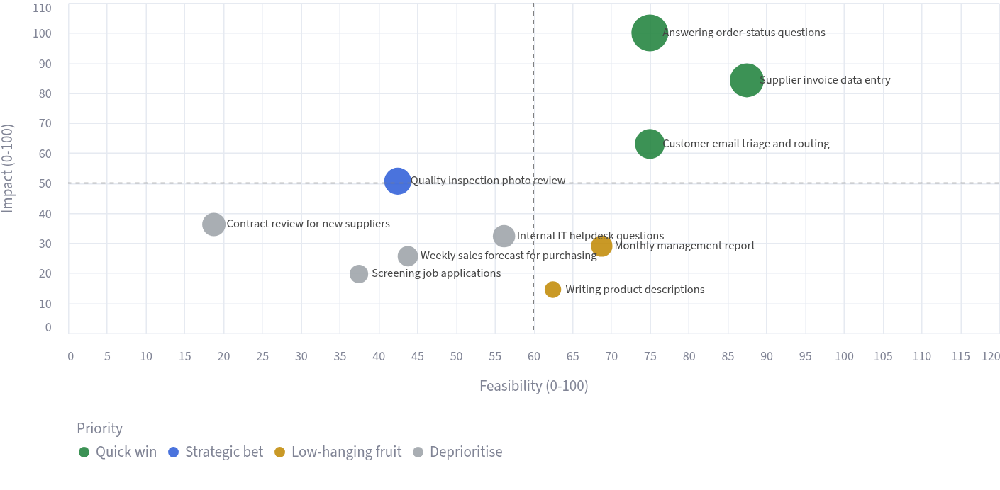

# AI Use-Case Prioritizer

**A consulting tool that answers the first question in every AI project: where should we start?**



## The problem
Companies are not short of AI ideas. What they lack is a defensible way to choose. Leadership asks "where can AI help us?", the team comes back with 30 ideas, and the loudest one gets funded. Consulting firms solve this with a workshop and a value × feasibility matrix. This app turns that workshop into a repeatable tool.

## How it works
1. **List the processes** that are candidates for AI: time spent, people involved, hourly cost, cost of errors, and the type of AI task (document extraction, classification & routing, Q&A over documents, drafting, forecasting).
2. **Rate feasibility** from 1 to 5: is the data available and clean, is the process standardised, how bad is it if the AI is wrong?
3. **Get the roadmap**: a matrix with four quadrants (quick wins, strategic bets, low-hanging fruit, deprioritise), the estimated annual value and payback of each use case, and a Markdown report ready to send to the client ([example](example_report.md)).

## The scoring framework (`prioritizer/scoring.py`)

| Dimension | Formula | Why |
|---|---|---|
| Annual cost of the process | hours/week × people × hourly cost × 48 + error cost × 12 | What the company pays today, including the cost of mistakes |
| Annual value | annual cost × automation potential of the AI pattern | AI rarely replaces a whole process; extraction automates more than forecasting |
| Impact (0–100) | value relative to the largest use case | Comparable across the list |
| Feasibility (0–100) | 40% data readiness + 35% standardisation + 25% low risk | Data is the most common reason AI projects stall |
| Payback | implementation cost ÷ monthly value | What a CFO asks first |

Every assumption (automation potential, implementation cost, weights) is in one place so it can be adjusted with the client. The defaults are my own estimates for illustration, not benchmarks.

## Example: a 200-person distribution company
With the sample data, 10 processes represent roughly **$507k/year** of addressable value. Three quick wins (order-status questions, invoice data entry, email triage) account for **$275k** of it, with an estimated payback of about 3 months each.

Two results are more interesting than the winners:
- **Screening job applications is deprioritised** despite being a popular idea. Mistakes carry high risk: hiring is a regulated, high-risk use of AI under the EU AI Act, and rules such as New York City's Local Law 144 apply in the US.
- **Contract review** is valuable per hour, but the data is unstructured and the cost of an error is high. It is a candidate for a supervised pilot, not a first project.

## Run it

```bash
pip install -r requirements.txt
streamlit run app.py
pytest
```

## Limitations
- The output is only as good as the inputs: time and cost estimates should come from process owners, not guesses.
- Automation potential varies a lot by company. After the first pilot, replace the defaults with measured results.
- Value is modelled as cost savings. Revenue effects (faster response → more sales) are not included, so the estimate is conservative for customer-facing processes.

---
Built by **Manuel Portugal Reis** · [LinkedIn](https://www.linkedin.com/in/manuelportugalreis/)
